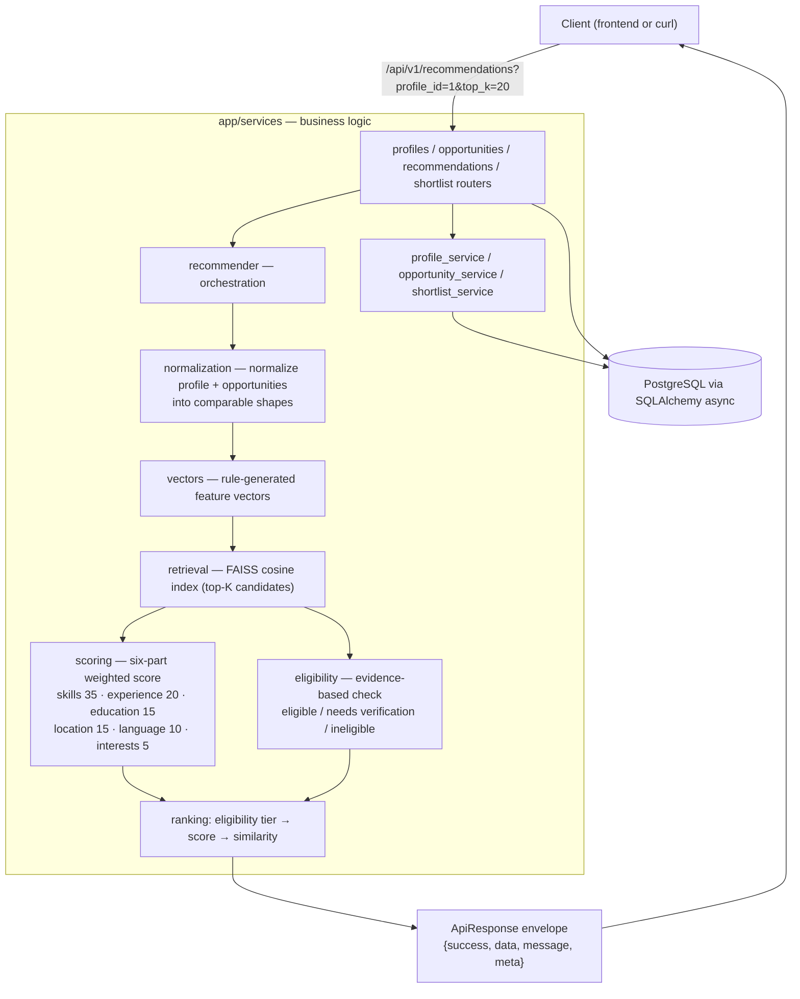

# Career Platform MVP — Backend

FastAPI + PostgreSQL backend for **PathPilot**, the career mobility MVP. It owns
the career **profiles**, the seeded catalog of **50 international opportunities**,
the **two-stage recommendation engine** (FAISS retrieval → weighted scoring →
eligibility), and each profile's **shortlist**.

Managed with [uv](https://docs.astral.sh/uv/), async end to end (asyncpg +
SQLAlchemy 2 async), fully layered (`api → services → models`), Pydantic-validated
at every boundary (requests, responses, environment), and a single JSON envelope
contract for all responses.

## What it does (used by the frontend)

1. **Profiles** — CRUD for a user's career profile: education, experience,
   skills, languages, location preferences, interests. The frontend's profile
   form and profile switcher are driven by these endpoints plus the taxonomy.
2. **Opportunities** — paginated, filterable listing and detail views of the
   seeded opportunity catalog, plus a per-opportunity **match explanation**
   endpoint used by the opportunity detail page.
3. **Recommendations** — the core feature: a ranked, fully explained match list
   for a profile (recomputed from live data on every request).
4. **Shortlist** — add/remove/list the opportunities a profile saved.
5. **Meta** — the reference taxonomy (countries, regions, skills, languages,
   education levels, career tracks) that powers form selects and scoring.

## Tech stack

| Concern        | Choice                                                                 |
| -------------- | ---------------------------------------------------------------------- |
| Language       | Python 3.13, dependency + lock management via [uv](https://docs.astral.sh/uv/) |
| Web framework  | FastAPI (app factory, lifespan seeding, global exception handlers)     |
| Database       | PostgreSQL 17 (Docker Compose, host port 5435)                          |
| ORM / migrations | SQLAlchemy 2.0 (async engine, asyncpg) · Alembic (sync psycopg2 driver) |
| Validation     | Pydantic v2 + pydantic-settings (env validated at startup, fail fast)  |
| Matching       | FAISS (CPU, in-memory cosine index) + NumPy feature vectors             |
| Quality        | pytest + pytest-asyncio + pytest-cov · ruff (lint + format)             |

## Request → recommendation workflow



Ranking rule: eligibility tier first (eligible → needs verification →
ineligible — constrained roles stay visible but sort below clean matches), then
total score, then cosine similarity, then id for determinism. Eligibility output
is automated guidance, not a legal determination.

## Run instructions (in order)

Prerequisites: Docker, [uv](https://docs.astral.sh/uv/) (Python 3.13).

```bash
cd backend

# 1. Start PostgreSQL (host port 5435)
make db-up

# 2. Install dependencies (creates .venv from uv.lock)
uv sync

# 3. Configure the environment (defaults work for local dev)
cp .env.example .env

# 4. Apply migrations
make migrate

# 5. Run the dev server (auto-reload)
make dev
```

- Swagger UI: http://127.0.0.1:8000/docs
- Health check: `GET /api/v1/health`
- On startup the app seeds **50 opportunities + demo profiles**
  (`app/services/seed_service.py`) so the frontend is usable immediately.

## API (mounted under `/api/v1`)

| Method   | Path                                | Description                                             |
| -------- | ----------------------------------- | ------------------------------------------------------- |
| `GET`    | `/health`                           | Liveness + database check                               |
| `GET`    | `/meta/taxonomy`                    | Reference taxonomy (countries, skills, languages, …)    |
| `POST`   | `/profiles`                         | Create a profile                                        |
| `GET`    | `/profiles`                         | List profiles (paginated)                               |
| `GET`    | `/profiles/{id}`                    | Retrieve one profile                                    |
| `PATCH`  | `/profiles/{id}`                    | Partial update (send only changes)                      |
| `DELETE` | `/profiles/{id}`                    | Delete a profile                                        |
| `GET`    | `/opportunities`                    | List opportunities (paginated, filterable)              |
| `GET`    | `/opportunities/{id}`               | Retrieve one opportunity                                |
| `GET`    | `/opportunities/{id}/match`         | Explain the match between a profile and this opportunity |
| `GET`    | `/recommendations?profile_id=&top_k=` | Ranked, explained recommendations for a profile       |
| `GET`    | `/shortlist?profile_id=`            | List shortlisted opportunities for a profile            |
| `POST`   | `/shortlist`                        | Add an opportunity to a profile's shortlist             |
| `DELETE` | `/shortlist/{profile_id}/{opportunity_id}` | Remove an opportunity from the shortlist         |

Every response uses the standard envelope:

```json
{"success": true, "data": {"id": 1, "name": "Ada Lovelace", "email": "ada@example.com", ...}, "message": "Profile created.", "meta": null}
```

Errors (validation, not found, duplicate email, …) are produced by global exception handlers:

```json
{"success": false, "error": {"code": "EMAIL_ALREADY_REGISTERED", "message": "...", "details": [{"field": "email", "message": "...", "code": "..."}]}}
```

## Configuration

All settings live in `.env` (see `.env.example` for the annotated template) and are validated at
startup by `app/core/config.py` — a malformed value crashes the process immediately instead of
surfacing mid-request. `DATABASE_URL` can override the discrete `POSTGRES_*` parts for managed
Postgres (Railway & co.). `CORS_ORIGINS` must include the frontend origin (defaults cover
`http://localhost:3000`).

## Project layout

```
app/
├── main.py               # Application factory, lifespan (seeding), middleware, handler registration
├── api/v1/               # Routers (thin — parse/validate, delegate to services)
│   ├── health.py, meta.py, profiles.py
│   ├── opportunities.py, recommendations.py, shortlist.py
├── core/                 # Config, async DB engine/session, envelope, exceptions, handlers, deps
├── models/               # SQLAlchemy ORM models (import all in models/__init__ for Alembic)
├── schemas/              # Pydantic request/response schemas
├── services/             # Business logic + all queries
│   ├── recommender.py    # Two-stage pipeline orchestration
│   ├── vectors.py, retrieval.py  # Feature vectors + FAISS cosine index
│   ├── scoring.py        # Fixed six-part weighted score (100 pts)
│   ├── eligibility.py    # Evidence-based eligibility evaluation
│   ├── normalization.py  # Profile/opportunity normalization
│   ├── profile_service.py, opportunity_service.py, shortlist_service.py
│   ├── taxonomy.py, seed_service.py
├── seed_data/            # The 50 seeded opportunities
└── utils/                # Shared helpers (grows as the MVP does)
alembic/                  # Migrations (sync psycopg2 driver, URL injected from settings)
tests/                    # pytest + pytest-asyncio; run against a throwaway test database
```

## Testing & linting

```bash
make test    # pytest — uses the dedicated career_platform_mvp_test database
make lint    # ruff check
make fmt     # ruff format
```
